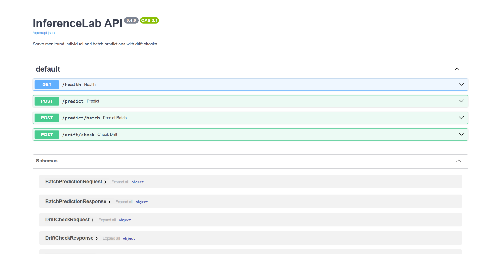
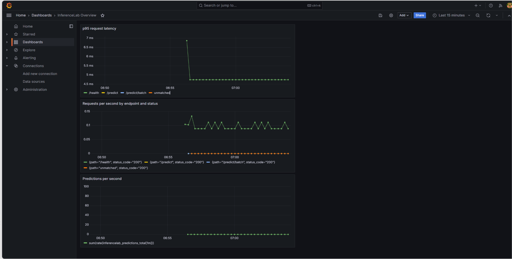

# InferenceLab

[](https://github.com/Taibi1234/InferenceLab/actions/workflows/ci.yml)

InferenceLab is a reproducible machine-learning training and model-serving
project built with Python. It combines model evaluation, REST APIs, batch
inference, performance benchmarking, data-drift detection, containerization,
continuous integration, and monitoring.

The example uses scikit-learn's built-in wine recognition dataset. This is an
educational portfolio project, not a production-ready deployment.

## Screenshots

### API documentation



### Monitoring dashboard



## Features

- Reproducible training with a fixed random seed
- Five-fold stratified cross-validation on training data only
- Final evaluation on an untouched holdout set
- JSON experiment metrics and JSONL experiment history
- Individual and batch prediction endpoints
- Request validation with Pydantic
- Automated API, training, benchmark, and drift tests
- Performance benchmarks with latency percentiles and throughput
- Prometheus-compatible application metrics
- Grafana and Prometheus monitoring through Docker Compose
- Batch data-drift detection using the Population Stability Index
- Docker builds with automated container health checks
- GitHub Actions continuous integration

## Architecture

```text
Wine dataset
    ↓
Training and stratified cross-validation
    ↓
Model artifact and training reference distributions
    ↓
FastAPI service ──→ Individual and batch predictions
    │
    ├──→ Batch data-drift analysis
    │
    └──→ Application metrics ──→ Prometheus ──→ Grafana
```

## Technology

- Python
- FastAPI and Pydantic
- scikit-learn, pandas, NumPy, and Joblib
- pytest
- Docker and Docker Compose
- Prometheus and Grafana
- GitHub Actions

## Project structure

```text
InferenceLab/
├── .github/workflows/
│   └── ci.yml
├── app/
│   ├── drift.py
│   ├── main.py
│   ├── metrics.py
│   ├── model_service.py
│   └── schemas.py
├── artifacts/
│   ├── benchmark.json
│   ├── experiment_history.jsonl
│   └── metrics.json
├── docs/images/
│   ├── api-docs.png
│   └── grafana-dashboard.png
├── monitoring/
├── scripts/
│   ├── benchmark.py
│   └── train.py
├── tests/
├── compose.yaml
├── Dockerfile
├── LICENSE
├── pytest.ini
└── requirements.txt
```

The generated `artifacts/model.joblib` file is excluded from Git. It is
recreated by running the training script or building the Docker image.

## Run locally

### Prerequisites

- Python 3.12 or newer
- PowerShell for the commands shown below

### Setup

```powershell
py -m venv .venv
Set-ExecutionPolicy -Scope Process Bypass
.\.venv\Scripts\Activate.ps1
python -m pip install --upgrade pip
python -m pip install -r requirements.txt
```

### Train the model

```powershell
python scripts/train.py
```

Training performs cross-validation on the training partition, selects the
model with the highest mean macro F1, and evaluates it on the holdout set.

Generated artifacts:

- `artifacts/model.joblib`: model, feature metadata, and drift reference data
- `artifacts/metrics.json`: latest experiment results
- `artifacts/experiment_history.jsonl`: appended experiment records

### Start the API

```powershell
uvicorn app.main:app --reload
```

Interactive documentation:

```text
http://127.0.0.1:8000/docs
```

## API endpoints

| Method | Endpoint | Purpose |
|---|---|---|
| GET | `/health` | Check service and model status |
| GET | `/metrics` | Expose Prometheus-compatible metrics |
| POST | `/predict` | Classify one 13-feature row |
| POST | `/predict/batch` | Classify 1–1,000 rows |
| POST | `/drift/check` | Compare 30–1,000 rows with training distributions |

### Individual prediction example

```json
{
  "features": [
    14.23,
    1.71,
    2.43,
    15.6,
    127,
    2.8,
    3.06,
    0.28,
    2.29,
    5.64,
    1.04,
    3.92,
    1065
  ]
}
```

Example response:

```json
{
  "predicted_class": 0,
  "confidence": 0.99
}
```

This response is illustrative. Exact confidence values depend on the trained
model.

## Model evaluation

Model selection uses five-fold stratified cross-validation on the training
data only. The holdout set is reserved for final evaluation.

The latest recorded experiment selected logistic regression:

| Metric | Result |
|---|---:|
| Cross-validation macro F1 mean | 0.9796 |
| Cross-validation macro F1 standard deviation | 0.0273 |
| Holdout accuracy | 0.9722 |
| Holdout macro F1 | 0.9710 |

These results come from a small built-in demonstration dataset and should not
be interpreted as evidence of performance on other datasets.

Complete results are stored in `artifacts/metrics.json`.

## Automated tests

Train the model before running the complete test suite:

```powershell
python scripts/train.py
python -m pytest -q
```

Tests cover API behavior, request validation, batch limits, training
artifacts, experiment history, benchmark utilities, and drift detection.

## Performance benchmark

With the API running, execute the benchmark from another terminal:

```powershell
python scripts/benchmark.py --requests 100 --batch-size 50 --batches 20
```

The benchmark measures:

- Mean, p50, p95, and p99 request latency
- Requests per second
- Predictions per second
- Individual versus batch throughput

Results are saved to `artifacts/benchmark.json`.

Measurements come from one sequential client and depend on the hardware,
software environment, and background workload. They are not universal
performance guarantees.

## Docker

Build the image:

```powershell
docker build -t inferencelab:latest .
```

Run the API:

```powershell
docker run --rm -p 8000:8000 --name inferencelab inferencelab:latest
```

The model is trained automatically during the image build, so no pre-existing
model artifact is required.

## Monitoring stack

Start the API, Prometheus, and Grafana:

```powershell
docker compose up --build -d
docker compose ps
```

Available interfaces:

| Service | Address |
|---|---|
| API documentation | http://127.0.0.1:8000/docs |
| Prometheus | http://127.0.0.1:9090 |
| Grafana | http://127.0.0.1:3000 |

For local development, Grafana's initial username and password are both
`admin`. Do not use these credentials for a public deployment.

Generate traffic for the dashboards:

```powershell
python scripts/benchmark.py --requests 100 --batch-size 50 --batches 20
```

Stop the monitoring stack:

```powershell
docker compose down
```

## Data-drift detection

The drift endpoint compares incoming batch feature distributions with
training-data reference distributions using PSI.

Current operational thresholds:

| PSI | Interpretation |
|---|---|
| Below 0.10 | No significant drift signal |
| 0.10 to below 0.25 | Moderate drift signal |
| 0.25 or higher | Significant drift signal |

These thresholds are heuristics, not proof that model performance has
changed. Drift results should prompt investigation rather than automatic
retraining without validation.

## Continuous integration

GitHub Actions performs these checks for pushes and pull requests targeting
`main`:

1. Installs dependencies in a clean environment
2. Trains the model
3. Runs the automated tests
4. Builds the Docker image
5. Starts the container and checks its health endpoint
6. Validates the Docker Compose configuration

## Limitations

- The built-in wine dataset is small and intended for demonstration.
- Experiment history uses local JSONL files rather than a multi-user registry.
- Application metrics reset when the API process restarts.
- The included monitoring credentials are for local development only.
- Authentication, TLS, and production deployment controls are not included.
- Drift signals do not measure model accuracy without labeled incoming data.

## Possible future improvements

- Authentication and authorization
- A dedicated model registry and experiment database
- Cloud deployment with managed monitoring
- Additional datasets and model types
- Validated, manually approved retraining workflows

## License

This project is available under the MIT License.